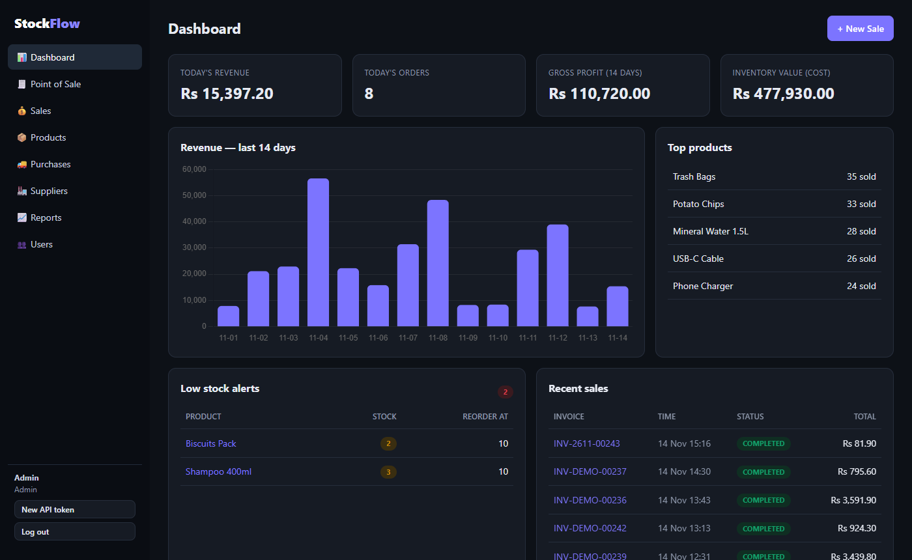
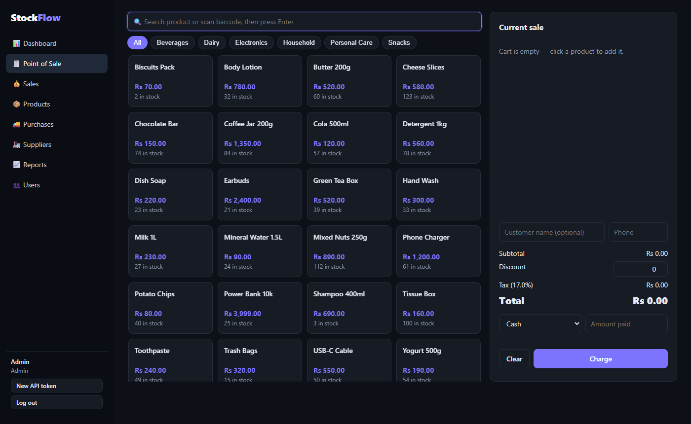
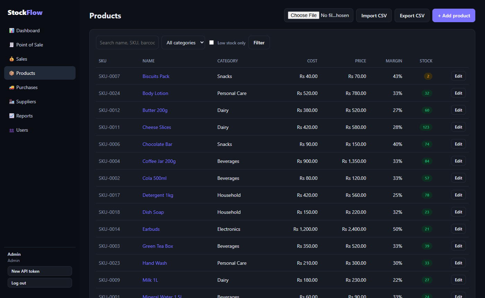
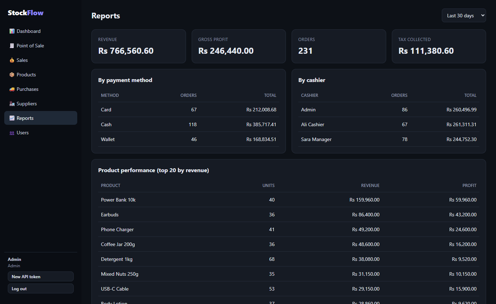

# StockFlow — Inventory & Point-of-Sale Platform

> **Showcase repository.** The source code is private; screenshots and a feature overview are below. Code walkthroughs available on request.

**Live demo:** https://muazzam-stockflow.vercel.app (`admin@stockflow.test` / `Demo@12345`) · **Author:** Muazzam Khan

A full retail inventory and POS system: role-based access, an audit trail for every stock change, atomic checkout, purchase orders, reports and a REST API.

## Features

- **Dashboard** — today's revenue and orders, 14-day revenue chart, gross profit, inventory value, low-stock alerts, top products
- **Point of Sale** — product grid, barcode scan, categories, discounts, tax, cash/card/wallet, change calculation, printable receipts
- **Products** — SKU/barcode, categories, margins, reorder levels, CSV import/export
- **Stock ledger** — every sale, purchase, return and adjustment recorded with user, reference and running balance
- **Purchasing** — supplier purchase orders; receiving updates stock and cost price
- **Sales & refunds** — filters, invoices, refunds that restock, CSV export
- **Reports** — revenue, profit, tax; by payment method, cashier and product
- **Roles** — Admin / Manager / Cashier · **REST API** with token auth

| POS | Products | Reports |
|---|---|---|
|  |  |  |

## Tech stack

Python · Flask · SQLAlchemy · PostgreSQL · Flask-Login · CSRF protection · Chart.js · Docker · Gunicorn · pytest
